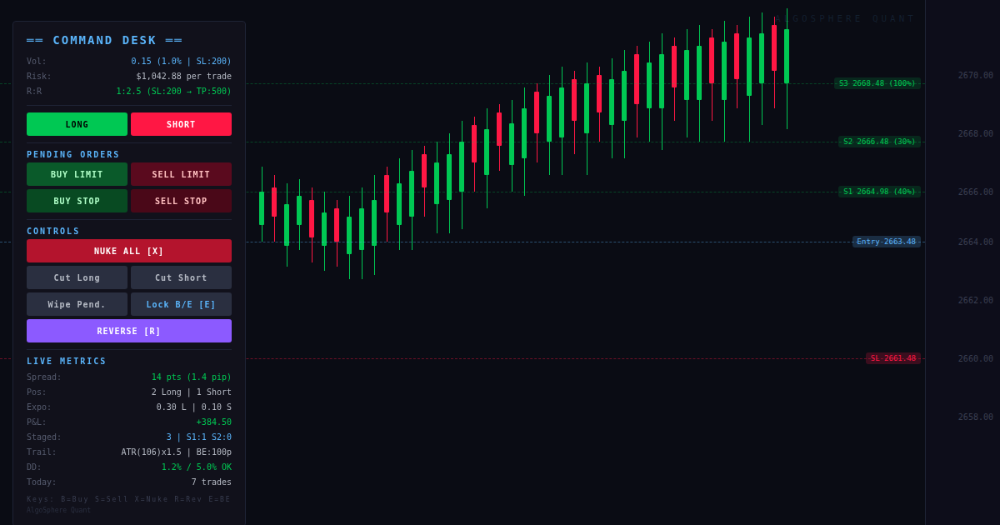
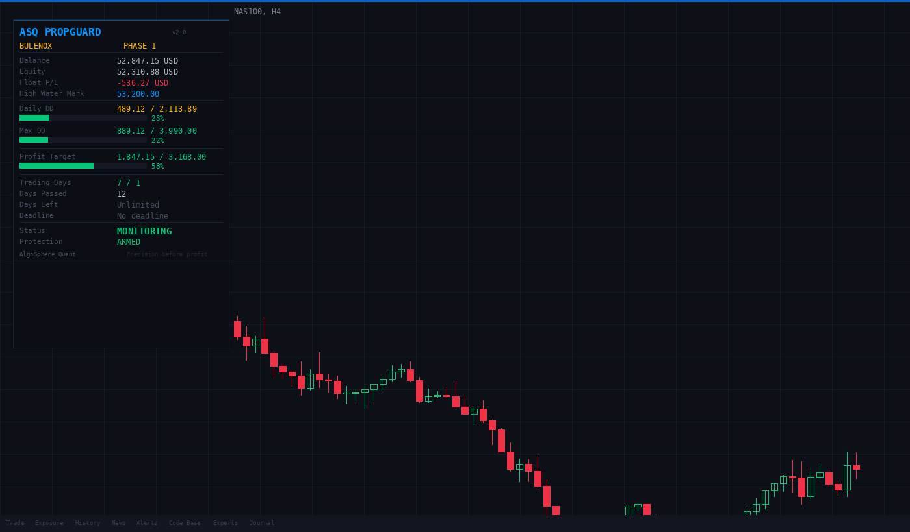
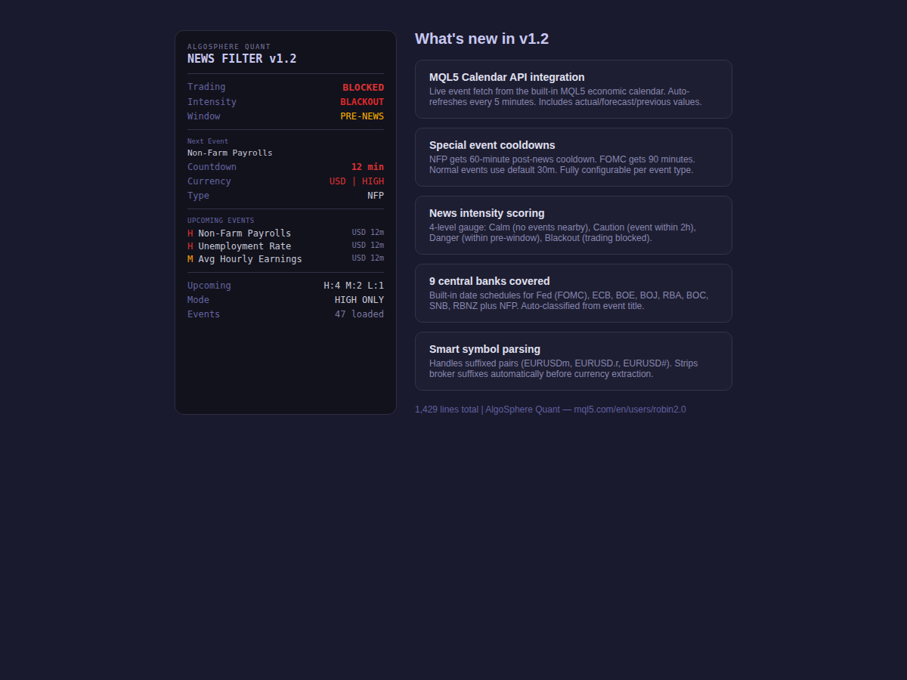
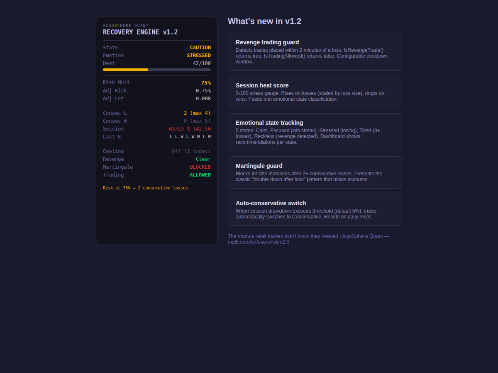

# Algorithmic Trading — AlgoSphere Quant open-source tools

[](https://github.com/e49nana/algorithmic-trading/actions/workflows/ci.yml)
[](LICENSE)

Free trading tools for **MetaTrader 5** and **NinjaTrader 8**: a scalping EA with its presets and Monte Carlo report, prop-firm and risk utilities, reusable MQL5 libraries, Smart Money Concepts indicators for NinjaTrader, and a tested Python Monte Carlo module.

Everything here is the free, open-source side of [AlgoSphere Quant](https://www.mql5.com/en/users/robin2.0). Paid products are sold on the MQL5 Market and their source is not in this repository.

| Area | Content | Folder |
|---|---|---|
| MetaTrader 5 | 3 Expert Advisors, 3 example EAs, 3 indicators, 1 script, 10 include libraries, 5 presets | [`mql5/`](mql5) |
| NinjaTrader 8 | 10 indicators, 5 strategies | [`ninjatrader/`](ninjatrader) |
| Python | Monte Carlo simulations for trading and risk, 29 tests | [`python/`](python) |
| Docs | Risk framework, product pages, Monte Carlo report | [`docs/`](docs) |

---

## Quick start — MetaTrader 5

1. Download the repository (**Code → Download ZIP**) or clone it.
2. In MetaTrader 5: **File → Open Data Folder**, then open the `MQL5` folder.
3. Copy the **contents** of this repository's `mql5/` folder into it. `Experts`, `Indicators`, `Scripts`, `Include` and `Presets` merge with the folders already there.
4. In MetaEditor, compile the programs you want under `Experts/AlgoSphere`, `Indicators/AlgoSphere` and `Scripts/AlgoSphere`.

The `mql5/` folder mirrors the terminal's own `MQL5` folder, so every `#include` resolves without editing.

---

## MetaTrader 5 catalogue

### Expert Advisors — `mql5/Experts/AlgoSphere/`

| Program | What it does | Docs |
|---|---|---|
| `ASQ_SafeScalping.mq5` | Breakout scalping EA for XAUUSD M5: EMA 50/200 trend, RSI, breakout, optional H1 confirmation, trailing, partial close at TP1, daily trade cap, peak drawdown stop. No martingale, grid or hedging. Uses `Include/ASQSafeScalping/`. | [product page](docs/products/ASQ_SafeScalping.md) · [Monte Carlo report](docs/reports/ASQ_SafeScalping_MonteCarlo_XAUUSD_M5.html) |
| `ASQ_CommandDesk.mq5` | Command center for manual traders: one-click orders, hotkeys (B/S/X/R), staged multi-TP, adaptive trailing, drawdown guard, live R:R and metrics. | [screenshots](#screenshots) |
| `ASQ_EquityCurve.mq5` | Live equity and balance curve on the chart: 4 display modes, drawdown, high-water mark, daily P&L, profit factor, streaks. | [screenshot](docs/images/ASQ_EquityCurve_Panel.png) |

**Examples** — `mql5/Experts/AlgoSphere/Examples/`: each one shows how to wire a library into an EA.

| Program | Library shown |
|---|---|
| `ASQ_NewsFilter_Demo.mq5` | `ASQ_NewsFilter.mqh` |
| `ASQ_RecoveryEngine_Demo.mq5` | `ASQ_RecoveryEngine.mqh` |
| `ASQ_TelegramNotifier_Demo.mq5` | `ASQ_TelegramNotifier.mqh` |

### Indicators — `mql5/Indicators/AlgoSphere/`

| Program | What it does | Docs |
|---|---|---|
| `ASQ_PropGuard.mq5` | Prop-firm challenge monitor: daily and maximum drawdown, profit target, trading days, deadline, 7 firm presets. **The auto-close option does not work yet**, see [Known issues](#known-issues). | [product page](docs/products/ASQ_PropGuard.md) |
| `ASQ_RiskReward.mq5` | Visual trade planner: drag entry/SL/TP lines, live R:R, lot size, up to 3 TPs, risk and reward in account currency. | [product page](docs/products/ASQ_RiskReward.md) |
| `ASQ_SpreadLogger.mq5` | Live spread histogram, statistics panel, threshold alerts and per-tick CSV export. | — |

### Scripts — `mql5/Scripts/AlgoSphere/`

| Program | What it does | Docs |
|---|---|---|
| `ASQ_JournalExport.mq5` | One-click CSV export of the trade history with R:R, win rate, expectancy, streaks, best/worst trade and average duration. | [product page](docs/products/ASQ_JournalExport.md) |

### Libraries — `mql5/Include/`

| File | Purpose |
|---|---|
| `AlgoSphere/ASQ_NewsFilter.mqh` | Economic-calendar guard (MQL5 Calendar API): blocks trading around events, cooldowns, intensity score, next-events panel. |
| `AlgoSphere/ASQ_RecoveryEngine.mqh` | Anti-tilt risk control: revenge-trade guard, heat score, risk reduction after losses, martingale protection. |
| `AlgoSphere/ASQ_TelegramNotifier.mqh` | Telegram alerts: trade events, daily/weekly summaries, several chats, silent hours, retry queue. Token and chat ID are inputs, never constants. |
| `AlgoSphere/PositionSizer.mqh` | Risk-based lot sizing from stop distance, tick value and broker volume limits. |
| `AlgoSphere/StopLossManager.mqh` | Stop-loss placement and management helpers. |
| `AlgoSphere/SpreadMonitor.mqh` | Spread statistics and filtering. |
| `ASQSafeScalping/ASQCore.mqh` | Safe Scalping: enums, structs, logging, utilities. |
| `ASQSafeScalping/ASQStrategy.mqh` | Safe Scalping: 7-condition signal engine. |
| `ASQSafeScalping/ASQTrading.mqh` | Safe Scalping: execution, risk, break-even, trailing, partial close, peak drawdown. |
| `ASQSafeScalping/ASQDashboard.mqh` | Safe Scalping: on-chart cockpit and analytics panel. |

### Presets — `mql5/Presets/ASQ_SafeScalping/`

The production preset for XAUUSD M5 and the four `.set` files of the optimisation workflow, explained in the [Safe Scalping product page](docs/products/ASQ_SafeScalping.md#preset-files).

### Screenshots

<p align="center">


</p>
<p align="center">


</p>

More in [`docs/images/`](docs/images).

---

## NinjaTrader 8 — `ninjatrader/`

**Install:** copy the `.cs` files into `Documents/NinjaTrader 8/bin/Custom/Indicators` (or `Strategies`), then compile from the NinjaScript Editor (F5).

### Indicators

| File | What it does |
|---|---|
| `SMC_LiquidityMaster.cs` | Smart Money Concepts liquidity: sell-side/buy-side liquidity, grabs, traps, points of interest, trendlines, M15 + H4. |
| `LiquidityZonesWithTrendlines.cs` | Buy/sell-side liquidity from equal highs/lows and trendlines. |
| `OrderBlockDetector.cs` | Bullish and bearish order blocks after a break of structure; levels exposed to strategies. |
| `FairValueGapDetector.cs` | Bullish and bearish fair value gaps. |
| `ChangeOfCharacterDetector.cs` | Change of character (CHoCH) with structure-break validation. |
| `PremiumDiscountZones.cs` | Premium and discount zones from Fibonacci levels, automatic trend detection. |
| `Anissa20.cs` | Swing structure: break of structure, order blocks, CHoCH, market structure breaks, session-aware alerts. |
| `Sola1.cs` | Swing breakout on NinjaTrader's native Swing, with CHoCH, volume and retest filters. |
| `DominantMovement.cs` | Dominant directional movement oscillator. |
| `Ichimoku.cs` | Ichimoku cloud (Tenkan, Kijun, Senkou A/B, Chikou). |

### Strategies

| File | What it does |
|---|---|
| `SophonScalpingStrategy.cs` | Multi-pattern scalping on EMA 19 with confluence scoring. |
| `LiquiditySweepProM15_Advanced.cs` | Liquidity-sweep entries on M15 with break-even and trailing. |
| `ZScoreMeanReversionStrategy.cs` | Z-score mean reversion: long at −threshold, short at +threshold, exit near the mean. |
| `DollarBasedSwingBreakStrategy.cs` | Swing-break entries with fixed dollar stop and target. |
| `TwoBarsStrategy.cs` | Two-bar pattern strategy. |

---

## Python — `python/`

`monte_carlo.py` simulates equity curves, final-capital and maximum-drawdown distributions, risk of ruin, GBM price paths, European option prices and Value at Risk. Every function is vectorised with NumPy and reproducible with `seed=`.

```bash
cd python
pip install -r requirements-dev.txt
pytest            # 29 tests, incl. option prices checked against Black-Scholes
python monte_carlo.py
```

```python
from monte_carlo import simulate_drawdown, risk_of_ruin

dd = simulate_drawdown(win_rate=0.55, avg_win=1.5, avg_loss=1.0, n_trades=200, risk_per_trade=0.01, seed=1)
print(f"95th percentile max drawdown: {dd.percentile_95:.1%}")
print(f"P(lose 30% within 500 trades at 2% risk): {risk_of_ruin(0.55, 1.5, 1.0, 0.02, 0.3, 500, seed=1):.2%}")
```

---

## Risk framework

The rules behind the EAs: [`docs/risk/`](docs/risk/README.md) — position sizing, drawdown recovery and Monte Carlo validation.

---

## Repository layout

```
algorithmic-trading/
├── mql5/                    # mirror of the terminal's MQL5 folder
│   ├── Experts/AlgoSphere/  #   EAs, Examples/ for the libraries
│   ├── Indicators/AlgoSphere/
│   ├── Scripts/AlgoSphere/
│   ├── Include/             #   AlgoSphere/ libraries, ASQSafeScalping/ modules
│   └── Presets/             #   .set files
├── ninjatrader/             # Indicators/, Strategies/ (NinjaScript C#)
├── python/                  # monte_carlo.py + tests/
├── docs/                    # risk/, products/, reports/, images/
├── tools/check_repo.py      # repository checks, run by CI
└── .github/                 # CI workflow, PR and issue templates
```

## Quality gates

Every pull request runs three jobs ([`.github/workflows/ci.yml`](.github/workflows/ci.yml)):

| Job | Checks |
|---|---|
| Repository checks | `tools/check_repo.py`: no archives, binaries or oversized files; no tokens, keys or hard-coded chat IDs; UTF-8 sources; MQL5 files in the right folder with the right event handlers; every `#include` resolves; no trade calls inside indicators; copyright and version present; no broken links; every source file listed in this README. |
| Python tests | `ruff` lint and format, `pytest` (29 tests). |
| Secret scan | gitleaks on the commits of the pull request. |

Run the same checks locally before pushing:

```bash
python tools/check_repo.py
cd python && ruff check . && pytest
```

MetaEditor and NinjaScript compilation are not automated (Windows-only tools): compile before opening a pull request, as the [PR checklist](.github/pull_request_template.md) asks. Builds (`.ex5`, packages) go to [GitHub Releases](https://github.com/e49nana/algorithmic-trading/releases), never into git.

## Known issues

- **`ASQ_PropGuard` auto-close does not run.** It is an indicator, and MetaTrader refuses trade functions inside indicators (error 4014), so its `PositionClose()` calls fail. Monitoring and alerts work; closing positions automatically needs the protection moved to an Expert Advisor. Tracked in `KNOWN_ISSUES` of `tools/check_repo.py`.

## Related repositories

- [e49nana/lokus-research](https://github.com/e49nana/lokus-research) — quantitative research on intraday futures (walk-forward backtesting).
- [e49nana/Djibril-AI](https://github.com/e49nana/Djibril-AI) — crude-oil trading system driven by geopolitical analysis (FastAPI, React, MetaTrader 5 EA).

## Disclaimer

Trading involves significant risk of loss. This code is provided for education and research. Backtest and Monte Carlo results describe the past and do not guarantee future results. Test on a demo account before any live use.

## Author and license

**Emmanuel Nana Nana** — AlgoSphere Quant · [MQL5 profile](https://www.mql5.com/en/users/robin2.0) · B.Sc. Applied Mathematics & Physics, TH Nürnberg

Code in this repository: [MIT](LICENSE). AlgoSphere Quant paid products: proprietary.
