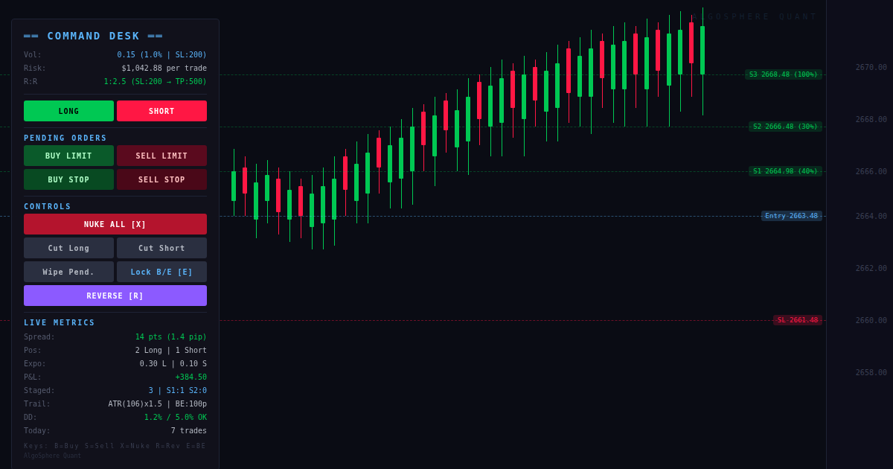
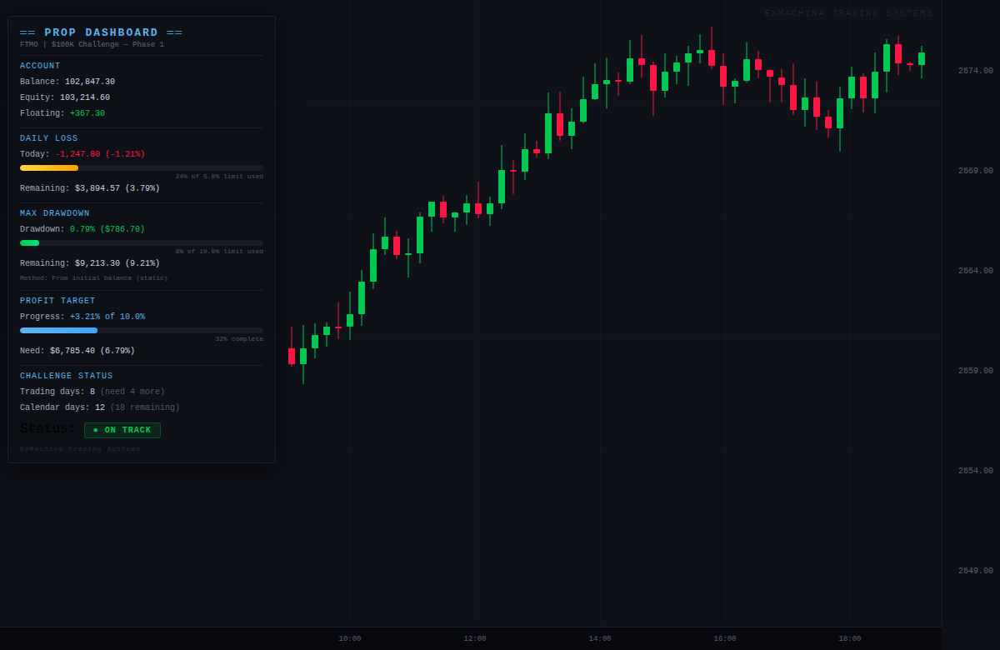
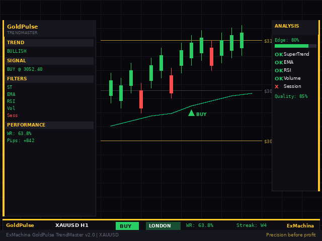
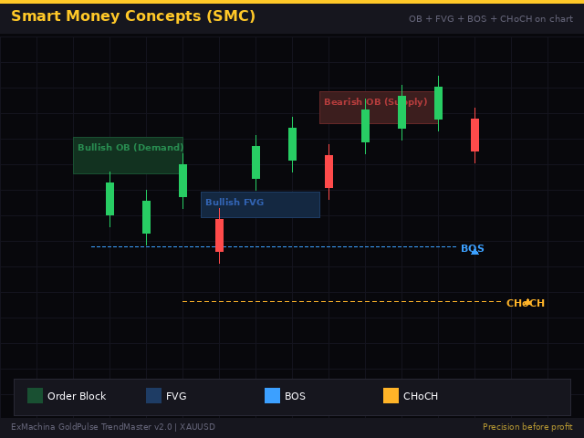

<div align="center">


[](#metatrader-5--mql5)
[](#ninjatrader-8--c)
[](#risk-management--analytics)
[](LICENSE)

**Trading tools for MetaTrader 5 and NinjaTrader 8 — indicators, risk utilities, Expert Advisors — plus the showcase of my commercial suite, [AlgoSphere Quant](https://algosphere-quant.com).**

</div>

---

## About

Everything in this repository is code I wrote for my own trading and for AlgoSphere Quant customers. The open-source parts are here in full; the commercial products are listed with links to the MQL5 Market, their source stays private.

| | MetaTrader 5 | NinjaTrader 8 |
|---|---|---|
| **Language** | MQL5 | C# (NinjaScript) |
| **Content** | 11 Expert Advisors / indicators, 12 include libraries, packaged builds | 13 indicators, 4 strategies |
| **Focus** | Prop-firm risk control, dashboards, scalping systems | Smart Money Concepts, liquidity, mean reversion |

---

## Spotlight — Djibril AI

> **My most advanced open-source system:** AI-powered crude oil trading based on real-time geopolitical analysis. Claude API scores Middle East tensions, a composite engine blends geopolitical, technical and sentiment signals, Kelly sizing computes position size, and a MetaTrader 5 EA executes. FastAPI backend, React/TypeScript dashboard, 98 tests, Docker deployment.

➡️ **[e49nana/Djibril-AI](https://github.com/e49nana/Djibril-AI)**

---

## Repository structure

```
Algorithmic-trading/
├── tradfi/
│   ├── ASQ_CommandDesk_v1.00.mq5          # command center for manual traders
│   ├── ASQ_NewsFilter.mqh (+ _Demo.mq5)   # economic-calendar trading guard
│   ├── ASQ_RecoveryEngine.mqh (+ _Demo)   # anti-tilt risk management
│   ├── ASQ/                               # Telegram notifier, spread logger, packaged ASQ builds
│   ├── mql5/                              # SafeScalperPro, dashboards, include libraries
│   │   └── ASQ_Legacy/                    # earlier versions, kept for reference
│   └── ninjatrader/
│       ├── Indicators/                    # 13 NinjaScript indicators (C#)
│       ├── Strategies/                    # 4 NinjaScript strategies (C#)
│       └── Utils/                         # risk-management notes, Monte Carlo (Python)
├── defi/contracts/FirstContract.sol       # a first Solidity learning contract
└── assets/                                # screenshots
```

---

## MetaTrader 5 — MQL5

### Expert Advisors and indicators (open source)

| File | What it does |
|---|---|
| `tradfi/ASQ_CommandDesk_v1.00.mq5` | Command center for manual traders: one-click position handling and risk display |
| `tradfi/ASQ_NewsFilter.mqh` + `ASQ_NewsFilter_Demo.mq5` | Economic-calendar trading guard using the MQL5 Calendar API, event cooldowns and intensity scoring |
| `tradfi/ASQ_RecoveryEngine.mqh` + `ASQ_RecoveryEngine_Demo.mq5` | Anti-tilt risk management: revenge-trade guard, heat scoring, martingale protection |
| `tradfi/ASQ/ASQ_TelegramNotifier.mqh` + `_Demo.mq5` | Telegram trade alerts, daily/weekly summaries, multi-chat, silent hours, retry queue |
| `tradfi/ASQ/ASQ_SpreadLogger.mq5` | Real-time spread monitoring, statistics and CSV logging |
| `tradfi/mql5/SafeScalperPro_v3.mq5` + `SSPCore/SSPStrategy/SSPTrading/SSPDashboard.mqh` | Breakout scalping system split into core, strategy, execution and dashboard modules |
| `tradfi/mql5/ASQ_PropDashboard.mq5` | Prop-firm dashboard: daily and maximum drawdown tracking against funded-account rules |
| `tradfi/mql5/ASQ_EquityCurve.mq5` | Live equity and balance curve drawn on the chart |
| `tradfi/mql5/ASQ_SupplyDemand.mq5` | Supply and demand zone detection |
| `tradfi/mql5/TradingAnalyticsSuite.mq5` | Trade statistics panel |
| `tradfi/ninjatrader/Utils/CorrelationMatrixPro.mq5` + `DashboardUI.mqh` | Multi-symbol correlation matrix with dashboard UI (MQL5, despite the folder) |

### Include libraries

`PositionSizer.mqh` (risk-based lot sizing), `StopLossManager.mqh`, `SpreadMonitor.mqh`, `AVGoldAsianBreakout.mqh` — all under `tradfi/mql5/`.

### Install

Copy `.mq5` files to `MQL5/Experts/` or `MQL5/Indicators/`, `.mqh` files to `MQL5/Include/`, then compile in MetaEditor. The `*_Demo.mq5` files show how each library is wired into an EA.

### Packaged builds

Zipped builds of several tools (`tradfi/ASQ/*.zip`, `tradfi/mql5/*.zip`, `tradfi/Algosphere_Quant_v2.10.zip`, `tradfi/Sophon_Complete_v1.2_Final.zip`) are committed for now; they will move to GitHub Releases.

<div align="center">
 
</div>

---

## NinjaTrader 8 — C#

### Indicators (`tradfi/ninjatrader/Indicators/`)

| File | What it does |
|---|---|
| `SMC_LiquidityMaster.cs` | Unified Smart Money Concepts indicator: sell-side/buy-side liquidity, grabs, traps, points of interest, trendlines, M15 + H4 |
| `SMC_LiquidityMap.cs` | Liquidity map for SMC setups |
| `LiquidityZonesWithTrendlines.cs` | Buy/sell-side liquidity from equal highs/lows and trendlines |
| `OrderBlockDetector.cs` | Bullish and bearish order blocks after a break of structure, levels exposed to strategies |
| `FairValueGapDetector.cs` | Bullish and bearish fair value gaps |
| `ChangeOfCharacterDetector.cs` | Change of character (CHoCH) with structure-break validation |
| `PremiumDiscountZones.cs` | Premium and discount zones from Fibonacci levels with automatic trend detection |
| `DominantMovement.cs` | Dominant directional movement |
| `Ichimoku.cs` | Ichimoku cloud |
| `VWAPx.cs` | Extended VWAP |
| `Anissa20.cs` | Swing validation indicator |
| `DollarBasedSwingBreakStrategy.cs` | Swing-break logic (strategy file kept with the indicators) |
| `../Sola1.cs` | Swing breakout indicator v1.2 |

### Strategies (`tradfi/ninjatrader/Strategies/`)

| File | What it does |
|---|---|
| `SophonScalpingStrategy.cs` | Sophon scalping strategy v2.0 |
| `LiquiditySweepProM15_Advanced.cs` | Liquidity sweep entries on M15 |
| `ZScoreMeanReversionStrategy.cs` | Z-score mean reversion |
| `TwoBarsStrategy.cs` | Two-bar pattern strategy |

### Install

NinjaTrader 8 → Tools → Import → NinjaScript Add-On, or drop the `.cs` files into `Documents/NinjaTrader 8/bin/Custom/Indicators` (or `Strategies`) and compile from the NinjaScript Editor.

<div align="center">
 
</div>

---

## Risk management & analytics

`tradfi/ninjatrader/Utils/` holds the written side of the risk work:

- `RISK_MANAGEMENT.md` — the rules behind the EAs
- `01-position-sizing.md`, `02-drawdown-recovery.md`, `04-monte-carlo.md` — notes on sizing, drawdown recovery and Monte Carlo validation
- `Python/Monte_Carlo.py` — Monte Carlo utilities for strategy validation and risk metrics (NumPy)

Quantitative research on intraday futures strategies lives in its own repository: **[e49nana/lokus-research](https://github.com/e49nana/lokus-research)** (walk-forward backtesting, 428 tests).

---

## AlgoSphere Quant — commercial products

> *Source code is private — links point to the MQL5 Market.*

### Flagship products

| Product | Description | Version |
|---|---|:---:|
| **Trade Manager PRO** | Position management — automated break-even, trailing, partial closes, TP ladders, session filter, journal export | v7.10 |
| **SafeScalperPro** | Automated scalping EA with risk management and prop-firm compliance | v3.0 |

### Product suite (14 products)

**Indicators:** SmartMoney Concepts, Liquidity Heatmap, Volume Profile, Divergence Scanner, Order Flow, Correlation Matrix, Session Control, Account Analytics, Risk Manager

**Utilities:** PropGuard (prop-firm compliance), Risk Manager (drawdown protection), Trade Journal, Position Sizer, News Filter

All products share the ASQ dark theme and common includes. Product pages: [mql5.com/en/users/robin2.0](https://www.mql5.com/en/users/robin2.0).

---

## Design principles

- **Deterministic execution** — timer-driven, no race conditions between ticks
- **Monotonic state machines** — trade states only move forward
- **Risk first** — every EA ships with drawdown limits and position sizing
- **Modular includes** — signal, filter, risk and execution are separate `.mqh` modules

---

## Solidity

`defi/contracts/FirstContract.sol` is a first learning contract (deposits, withdrawals, owner modifier, events). There is no other blockchain code in this repository.

---

## Disclaimer

Trading involves significant risk of loss. The code here is provided for educational and research purposes. Past performance does not guarantee future results. Test on a demo account before any live use.

## Author

**Emmanuel Nana Nana** — Founder, [AlgoSphere Quant](https://algosphere-quant.com) · B.Sc. Applied Mathematics & Physics, TH Nürnberg

[](https://github.com/e49nana)
[](https://www.mql5.com/en/users/robin2.0)

## License

Open-source code: [MIT](LICENSE). AlgoSphere Quant products: proprietary.

<div align="center">

</div>
